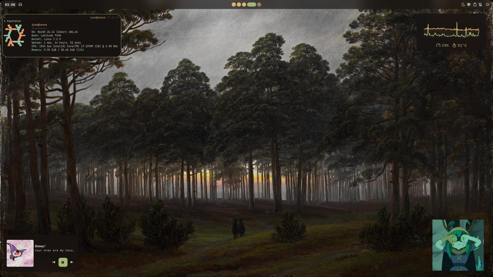
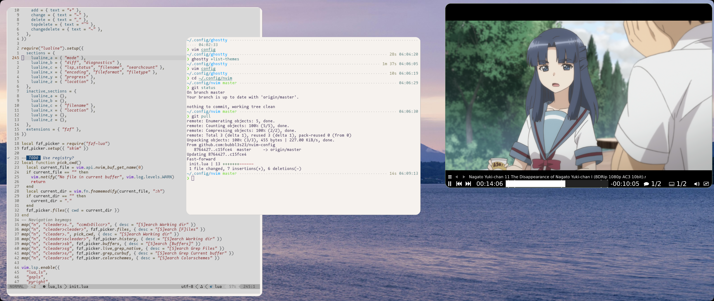
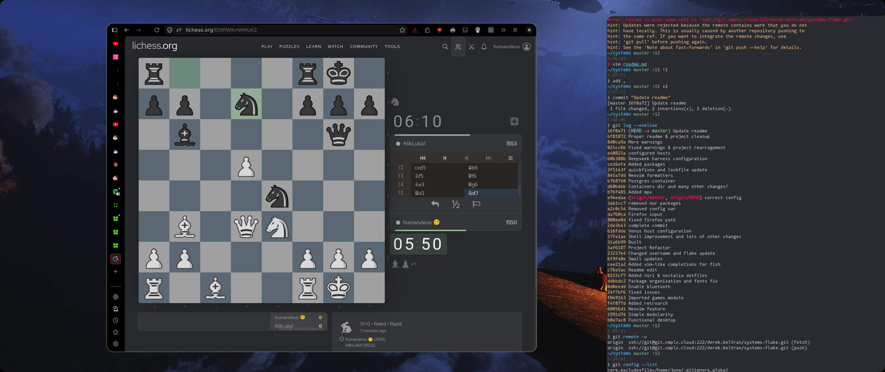
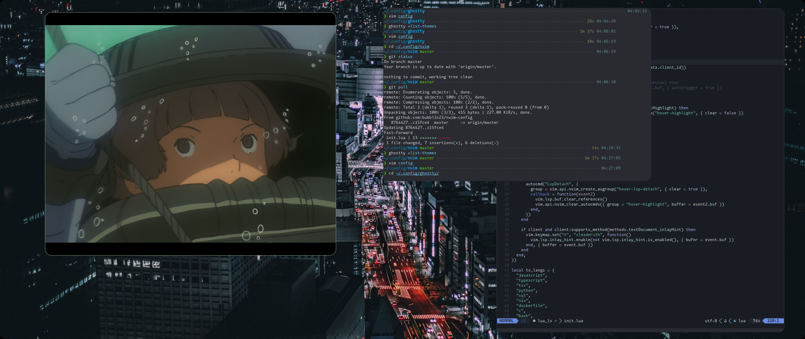

# Overview
I was pretty overwhelmed reading through complex and overengineered examples that use libraries and other confusing patterns.
I came up with this configuration after a short tutorial on the nix language and a few documentation pages. For that reason I'm not too sure if this flake breaks conventions or does something awfully wrong. I'll probably focus on this later and make one of those overblown configurations myself, but for now it just werks on my machines.

If you are also feeling lost jumping between l337 rice dotfiles this simpler approach may help you to get started.

# Some features
- Niri + Noctalia (best linux desktop).
- Some overlays for nightly builds (neovim, firefox).
- Fish shell
- TODO: Networking configuration between hosts

# Screenshots

