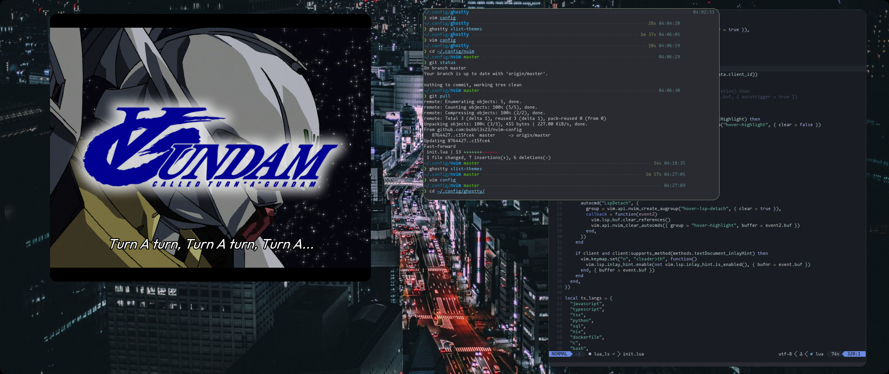

# Overview
I got overwhelmed reading through complex and overengineered flakes that use libraries, patterns and all of that.
I came up with this configuration after a short tutorial on the nix language and some documentation pages, so I'm not sure if I'm breaking conventions or doing something awfully wrong on here. I'll probably focus on this later and make one of those overblown configurations, but for now it just "werks" on my machines.

If you are also lost jumping between l337 rice dotfiles maybe my more simple solution can help you get started.

# Some features
- Niri + Noctalia (best linux desktop experience).
- Some overlays for nightly builds (neovim, firefox).
- Fish shell
- TODO: Networking configuration between hosts

# Screenshots

